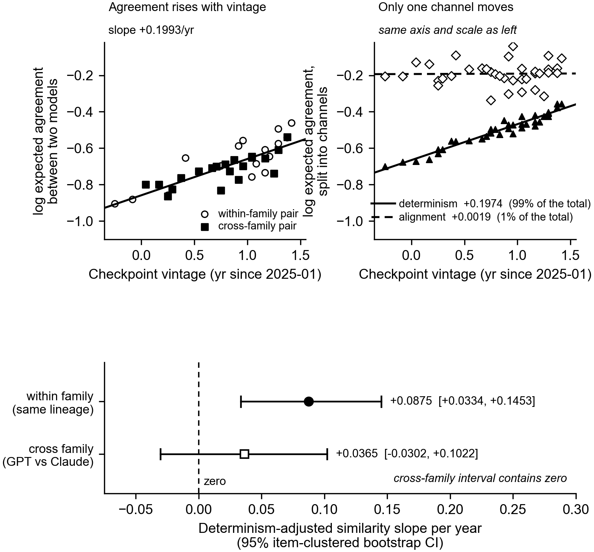

# STAGE 1 REPORT — policy similarity and policy convergence
2026-09-09/10. **Collection complete. Stage 1 ends here.** Total spend **$143.05** of $150 hard
($135 planned). Sources: `analysis/out/stage1_frame/`, `runs/`, `RUN_LEDGER.csv`.

---

## 0. Collection and integrity

| collection | calls | parse fail | transport fail | checkpoint mismatch | cost |
|---|---|---|---|---|---|
| availability probe | 17 | 0 | 1 (no vision) | 0 | $0.09 |
| code pilot (12 items x 9 ckpts x n=48) | 5,184 | 1 | 0 | 0 | $18.96 |
| liveness preflight (24 arrays x 2 ckpts x n=24) | 1,152 | 0 | 0 | 0 | $8.73 |
| **visual frame (41 arrays x 9 ckpts x n=48)** | **17,712** | **1** | 59 (all recovered) | **0** | **$115.27** |

**All integrity gates PASS.** One prompt generation (`d40ea45d`) throughout; every checkpoint
returned what was requested on all 24,065 successful calls; no duplicate trials; **zero rows returned
a thinking block**, so OFF is verified from responses, not assumed from requests. 368 of 369 visual
cells are at n=48; one is at n=47 (`gpt-4-turbo` x `F10_curvature_m3`) after a single parse failure,
flagged and **not** topped up — retrying only unparseable trials selects for parseable responses
(Threat 15).

The 59 transport failures were `APIConnectionError` bursts caused by **my own runner**, not by the
providers: jobs were ordered array → checkpoint → trial, so 48 consecutive jobs shared one endpoint
and all 30 workers hit it simultaneously while eight endpoints idled. 57 of 59 landed on the two
oldest GPT endpoints. All 59 were retried successfully with zero failures once the job list was
interleaved across endpoints. Recorded in D-031; both runners are fixed.

---

## 1. The headline: the raw convergence signal is 99% determinism

Raw cross-model match rises sharply with checkpoint vintage — the naive reading is "models are
converging". The exact decomposition says otherwise.

`log M_AB = ½ log M_AA + ½ log M_BB + log cos_raw`, residual **+2.4e-08**:

| channel | slope per year | share |
|---|---|---|
| total (log cross-model match) | **+0.1993** | 100% |
| **determinism channel** | **+0.1974** | **99%** |
| alignment channel | +0.0019 | 1% |

**Cross-model match rises with vintage almost entirely because models became more deterministic, not
because they became more similar to each other.** This is the study's central methodological claim,
and it is not a simulation result — it is what the data did.

**Figure 1. The rise in agreement between models is determinism, not alignment.** *Top left:*
expected agreement between the two members of a model pair on the same item, log scale, one point
per model pair (mean over all 41 arrays; 36 pairs). Agreement rises with checkpoint vintage,
slope +0.1993/yr. *Top right:* the same quantity on the same axis and scale, split by the exact
identity `log M_AB = ½ log M_AA + ½ log M_BB + log cos_raw` (residual 2.4e-08). The determinism
channel carries +0.1974/yr, 99% of the total; the alignment channel is flat at +0.0019/yr, 1%.
*Bottom:* the determinism-adjusted similarity slope by pair type, 95% item-clustered bootstrap CI.
**The cross-family estimate is null** — +0.0365 [−0.0302, +0.1022] contains zero — while the
within-family estimate does not. Fitted lines are OLS on all 1,476 pair×item rows; the design is
balanced at 41 items per pair, so aggregating to pair means leaves every slope unchanged to ~1e-15.
Panels are on the log scale because the decomposition is additive only there; on a raw match-rate
axis the fitted slope is +0.1215 and the channels do not sum to it. Reproduced from the frozen
merged dataset by `figures/make_fig_decomposition.py`, which asserts every plotted value against
`analysis/out/stage1_frame/convergence.json` before drawing. **Successive checkpoints of the same
lineage become more similar to each other; GPT and Claude do not demonstrably become more similar to
each other. Agreement between the two families is equally consistent with independent convergence on
the same conventions and with common inheritance from overlapping training corpora (Threat 10); this
study cannot distinguish them.**

---

## 2. Determinism rises monotonically with vintage, in both families

Cells where a model picks the same option on **all 48 trials**:

| checkpoint | vintage | fully deterministic cells | median effective support |
|---|---|---|---|
| `gpt-4-turbo-2024-04-09` | 2024-04 | 3/41 (7%) | 2.241 |
| `gpt-4.1-2025-04-14` | 2025-04 | 3/41 (7%) | 1.653 |
| `gpt-5-2025-08-07` | 2025-08 | 6/41 (15%) | 1.412 |
| `gpt-5.5-2026-04-23` | 2026-04 | 11/41 (27%) | 1.466 |
| `claude-opus-4-5-20251101` | 2025-11 | 4/41 (10%) | 1.653 |
| `claude-opus-4-6` | 2026-02 | 6/41 (15%) | 1.538 |
| `claude-opus-4-7` | 2026-04 | 12/41 (29%) | 1.180 |
| `claude-opus-4-8` | 2026-05 | 12/41 (29%) | 1.280 |
| **`claude-opus-5`** | 2026-07 | **21/41 (51%)** | **1.000** |

**On the median array of this battery, Claude Opus 5 picks the same option 48 times out of 48.**

This is reported as a substantive result, not a nuisance. Under a low-effort setting, the newest
checkpoints of both families hold a single option on an underdetermined four-way choice with no
observed variation at all. **17 of 41 arrays have all nine checkpoints sharing the modal option** —
across two independently developed families and 27 months of vintage.

---

## 3. The primary test, and the qualification that decides what it means

Determinism-adjusted similarity (`das`), tested against a determinism-matched null band:

- observed slope **+0.0696**, null band [−0.0282, +0.0375], **excess +0.0649, p = 0.000**
- `identifiable = **True**` — 345 pair×item rows meet the strict reference threshold

So similarity does increase beyond what determinism alone explains. **But the split that matters for
the research question is within- versus cross-family:**

| `das` slope per year | n rows | slope | 95% CI | |
|---|---|---|---|---|
| **within family** | 656 | **+0.0875** | [+0.0334, +0.1453] | excludes zero |
| **cross family** | 820 | **+0.0365** | [−0.0302, +0.1022] | **includes zero** |

**Successive checkpoints of the same lineage become more similar to each other. GPT and Claude do not
demonstrably become more similar to each other.** The research question asks about *independently
developed* models, and on that question this study's estimate is **null**, with a confidence interval
wide enough to contain both a modest convergence and a modest divergence.

**A tension to report rather than resolve.** The two alignment measures disagree on significance:
`cos_raw` slope is +0.0157 [−0.0146, +0.0454] (includes zero) while `das` is +0.0696 [+0.0259,
+0.1136] (excludes zero). They are not the same quantity — `cos_raw` is evaluated at each cell's own
determinism, `das` after standardising both cells to a common support — but a reader is entitled to
see both, and the pre-registered primary is `das`.

**Stratum check passes.** The trend is carried by *same*-stratum pairs (+0.0818 [+0.0291, +0.1358]),
not cross-stratum (+0.0436 [−0.0108, +0.0998]), so it is not a request-surface artefact. Note that
same-stratum and within-family are heavily confounded here, so the within/cross-family split above is
the more interpretable one.

---

## 4. The two declared strata (D-027)

- **Stratum F — full unscreened frame, 41 arrays.** Carries §2: prevalence of collapse, modal
  agreement, the shared-convention result. Needs no diffuseness.
- **Stratum L — liveness-screened, 9 of 41 arrays** (both screen checkpoints at support ≥ 1.5 under
  OFF): `F05_orient_m3`, `F12_mirror_m3`, `F15_ring_m3`, `F26_bumploc_m1`, `F30_pairratio_m1`,
  `F34_jitter_m1`, `F35_gradang_m1`, `F36_split_m1`, `F37_mirroraxis_m1`.

**Disclosure.** Stratum L conditions on a **generator property** — how graded a manipulation is —
reached through two checkpoints' *within-model* marginals. It conditions on no between-model
relationship. That is weaker than the rule that disqualified `FROZEN_22` ("GPT-5.5 share ≥ .75 and
FC ≥ .80", a rule on the dependent variable), but it is not absent, and both screen checkpoints are
themselves in the panel at its recent end.

**Correction to my own Gate 2 recommendation.** I sized the identifiability problem using `gpt-5.5`
and `claude-opus-5` — which §2 now shows are the **two most deterministic checkpoints in the panel**.
Against the full nine-checkpoint panel the estimable subset is **345 reference rows**, and the
primary test is identifiable. The liveness problem was real but smaller than I projected, because the
older checkpoints are diffuse where the newest ones are not. The preflight was still worth its $8.73:
it established that OFF does not rescue a collapsed cell, which is why §2 is a finding rather than an
artefact of the setting.

---

## 5. Code domain (12 items x 9 checkpoints x n=48)

Cross-family modal agreement **.829**, within-family **.922**, chance .25. **8 of 12 items unanimous
across both families and 24 months**: `rect(x, y, width, height)`, `raise ValueError`, `src/` layout,
lexicographic listing, `return (lowest, highest)`, `_MISSING = object()`, ISO-8601 with `Z`, `data`.

**One item diverges completely** — `code_iface_003`, cross-family agreement **0.00**: all four GPT
checkpoints choose `--verbose`; Claude chooses `--verbose` at 4.5 and `-v/-vv/-vvv` from 4.6 onward.
It survives the collapsed coding, so it is not an option-splitting artefact.

The pre-registered collapsed coding and the raw four-option coding are **identical to three decimals**
on all 12 items (D-026). T3's predicted splitting bias did not materialise, because the items
collapsed onto single options rather than splitting across near-synonyms.

---

## 6. What this does NOT show

1. **Not a cross-family convergence result.** §3: the cross-family `das` estimate is null.
2. **Not a claim about models, only about models at this setting.** Everything is thinking OFF /
   low effort. A thinking-ON condition may differ and is a follow-up (D-017, Threat 14).
3. **Not separable from common training data.** GPT and Claude train on overlapping public corpora;
   agreement is equally consistent with independent convergence and with common inheritance
   (Threat 10). Stage 1 cannot distinguish them.
4. **The vintage analysis is a GPT analysis with a short Claude window attached** — 24 months against
   8 at Opus tier (§4.2 of MASTER_DESIGN). A null Claude trend carries much less weight than a null
   GPT trend.
5. **The GPT control surface changes mid-ladder** at 2025-08 and cannot be held fixed (Threat 13).
6. **Mechanism-level CIs in `SUMMARY.md` §3 are degenerate and must not be quoted.** Each mechanism
   has exactly one array, so the item-clustered bootstrap has nothing to resample and returns the
   point estimate as both bounds.
7. **"Convergence on this fixed battery."** 41 visual arrays and 12 code items, one prompt
   generation, one n. Nothing here generalises to conventions off this battery.

---

## 7. Stage 1 stops here

Not started, and not to be started: partner prediction, identity framing, payoff calibration, green
assignment, stag-hunt strategic trials, non-strategic Worker trials.
